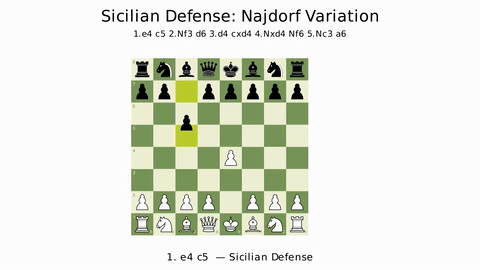
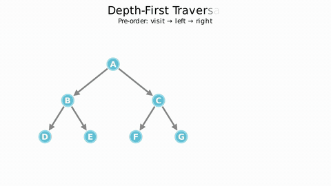
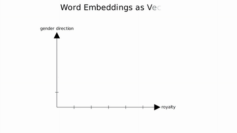
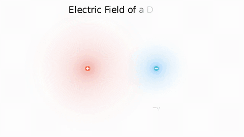
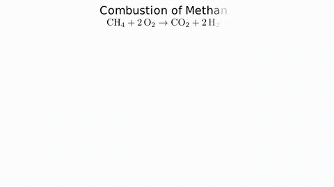
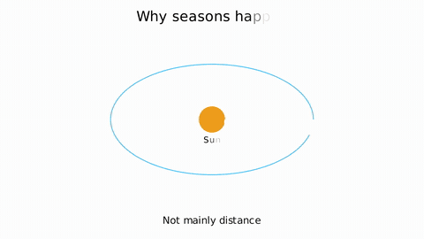
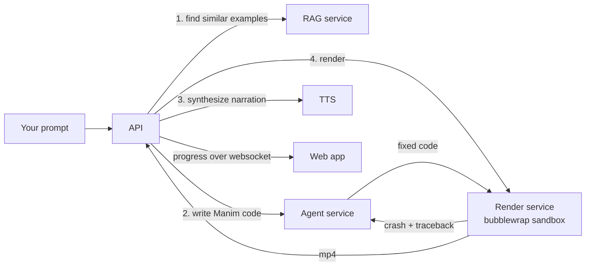

# Stitcher

Type a sentence. Get a narrated, animated explainer video, rendered with [Manim](https://www.manim.community/), the library behind 3Blue1Brown's videos.

Stitcher writes the Manim code for you, renders it in a sandbox, reads the render errors, fixes its own code, and adds a voiceover. Everything runs on your machine with `docker compose up`. You bring one LLM API key, or none at all if you run Ollama.

<table>
<tr>
<td><br><sub>Chess: the Najdorf Sicilian, move by move</sub></td>
<td><br><sub>Algorithms: depth-first traversal with its call stack</sub></td>
<td><br><sub>ML: king minus man plus woman</sub></td>
</tr>
<tr>
<td><br><sub>Physics: the field of an electric dipole</sub></td>
<td><br><sub>Chemistry: combustion of methane</sub></td>
<td><br><sub>Astronomy: why seasons happen</sub></td>
</tr>
</table>

Every clip above is unedited pipeline output, shown at 2x speed. The originals run 28 to 58 seconds and have a voiceover.

## Why this exists

Manim makes beautiful animations, and writing it is slow. A 30 second scene is a few hundred lines of Python, and most of the time goes into fixing overlapping labels and exceptions three minutes into a render.

LLMs can write Manim, but badly. They invent methods that don't exist and mix up APIs from three different Manim forks. Stitcher is the scaffolding that makes the output usable. It retrieves real working examples, checks the code before rendering, feeds render errors back to a debugger, and remembers what broke last time.

## What you get

- **Prompt to video in about a minute.** On a laptop, a typical run takes 60 to 80 seconds and produces 30 to 50 seconds of 720p video with narration.
- **Edit by asking.** "Make the arrows red and slow down the second half" re-renders the video with that change.
- **Six domain plugins** built in: chess boards and openings, data structures and algorithms, neural networks, physics fields and pendulums, molecules, and orbits. Each one ships with notes that teach the model how to use it.
- **Voiceover** that is timed to the animation, using free Google TTS by default, or Azure neural voices if you add a key.
- **A self-repair loop.** Code is linted and compiled before rendering. If Manim still crashes, the error goes to a debugger model, up to three times. After a fix, the system writes a short lesson so the coder doesn't repeat the same mistake on the next video.
- **Retrieval over 1,000+ Manim docs chunks and 300+ working example scenes**, so the coder starts from code that is known to render.
- **A timeline editor** in the browser for trimming clips, stacking audio, and adding text overlays, with MP4 export.
- **Sandboxed rendering.** Generated Python runs inside bubblewrap with no network and a dropped-privilege user.
- **Any model.** OpenAI, Anthropic, Gemini, OpenRouter and Ollama all work, and you can use a different model for each role.

## How it works



| Service | Stack | Job |
|---|---|---|
| `apps/api` | Express, TypeScript, BullMQ | Auth, projects, the job queue, and the pipeline that calls everything else |
| `apps/web` | React, Vite | Chat-style prompt box, live progress, video player, timeline editor |
| `services/agent` | Fastify, LangChain | Writes Manim code, validates it, debugs it, extracts lessons |
| `services/rag` | Fastify, MongoDB vector search | Rewrites the prompt into Manim terms and finds the closest working examples |
| `services/render` | FastAPI, Manim, bubblewrap | Runs the code in a sandbox and returns the video |

[docs/ARCHITECTURE.md](docs/ARCHITECTURE.md) walks through one request end to end.

## Quickstart

You need Docker with Compose v2 and about 12 GB of free disk. The first build installs a full LaTeX distribution for the renderer, so give it a while.

```bash
git clone https://github.com/vermarjun/stitcher.git
cd stitcher
./scripts/setup.sh        # writes .env with random secrets, asks for your LLM provider and key
docker compose up -d
```

Open http://localhost:8080, sign up, and type a prompt. The sign-up code is printed in the API log, so no email server is needed:

```bash
docker compose logs api | grep -i "otp"
```

Try one of these first: `Explain the Pythagorean theorem with squares on each side`, `Show bubble sort on 6 bars`, `Animate a double pendulum`.

### No API key? Use Ollama

```bash
./scripts/setup.sh --provider ollama --model qwen2.5-coder:14b
```

## Configuration

`.env` at the repo root is the only file you edit. The common settings:

| Variable | Default | What it does |
|---|---|---|
| `LLM_PROVIDER` | none | `openai`, `anthropic`, `gemini`, `openrouter` or `ollama` |
| `LLM_API_KEY` | none | Key for that provider (leave empty for Ollama) |
| `LLM_MODEL` | provider default | Model for every role unless overridden |
| `CODER_MODEL`, `DEBUGGER_MODEL` | `LLM_MODEL` | Use a stronger model for writing code and a cheaper one elsewhere |
| `EMBEDDER_PROVIDER` | `local` | Embeddings for retrieval. `local` runs a small model inside the RAG container with no key. `openai`, `gemini` and `ollama` also work |
| `TTS_PROVIDER` | `gtts` | `gtts` (free, no key), `azure`, or `off` |
| `STORAGE` | `local` | `local` volume, or `cloudinary` if you set `CLOUDINARY_*` |
| `EMAIL_PROVIDER` | `console` | `console` prints codes to the log, `smtp` sends real mail |

Everything else is in [docs/CONFIGURATION.md](docs/CONFIGURATION.md).


## Repository layout

```
apps/api          API and job pipeline
apps/web          web app
services/agent    code-writing agent, prompts in src/prompts
services/rag      retrieval service and corpus
services/render   sandboxed Manim renderer, vendored plugins
docs/             architecture, configuration, media
```

## Contributing

Bug reports with the prompt that failed are the most useful thing you can send. See [CONTRIBUTING.md](CONTRIBUTING.md) for running each service on its own and for the test commands. Security issues go to [SECURITY.md](SECURITY.md), not the issue tracker.

## Credits

Built on [Manim Community](https://github.com/ManimCommunity/manim). The retrieval corpus includes examples from the Manim docs. The renderer vendors patched copies of manim-chess, manim-dsa, manim-ml, manim-physics, manim-chemistry and manim-astronomy. Their licenses and upstream links are in [services/render/vendor/README.md](services/render/vendor/README.md).

## License

MIT. See [LICENSE](LICENSE).
