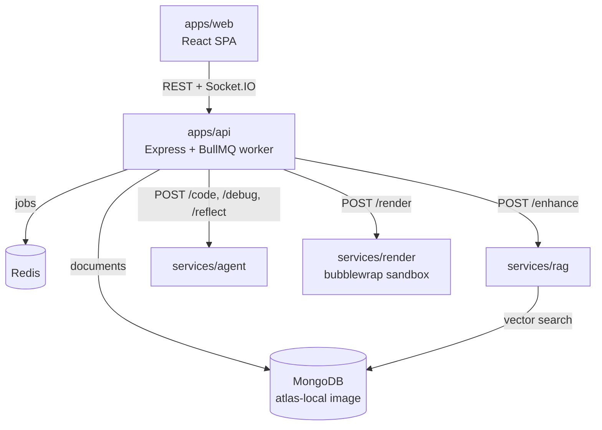

# How Stitcher works

This page follows one prompt from the text box to a finished MP4. If you want to change how videos get made, the code you care about is in `apps/api/src/queue/generationWorker.ts` and `services/agent/src/prompts/`.

## The five parts

Everything talks over HTTP inside the compose network. Each internal call carries a shared `X-Api-Key`. Only the web container is meant to face a browser.

## One generation, step by step

When you send a prompt, the API saves a chat message, puts a job on the `video-generation` BullMQ queue and answers right away with a `jobId`. A worker inside the API container picks it up. Two jobs run at once by default, and each job holds a 10 minute lock because rendering is slow and synchronous.

The worker then walks through these phases. Each one pushes a progress event through Redis pub/sub to Socket.IO, and also writes the percentage to the job document, so reloading the page puts the progress bar back where it was.

| Phase | What happens |
|---|---|
| `rag` | The prompt goes to the RAG service. It can rewrite the prompt into Manim vocabulary, list the APIs and plugins it thinks you need, then return the closest working example scenes. If RAG is down, the job continues without examples. |
| `code` | The API builds the coder request: your prompt, the RAG examples, your project's memory notes, and up to 25 recent "lessons" from past failures. The agent picks the matching plugin skill files, adds cheatsheet entries for the APIs in play, calls the model once, and validates the result before returning it. |
| `voiceover` | Every `self.voiceover(text=...)` line in the generated code is pulled out and synthesized, with gTTS by default or Azure if configured. A voiceover failure never fails the job. You just get a silent video. |
| `render` | The code, the scene class name and the audio files go to the render service, which runs Manim inside bubblewrap. |
| `debug` | If the render crashes, the traceback and the broken code go to the agent's debugger. Up to three rounds. If the render service itself is unreachable, the debug loop is skipped, since there is nothing for the model to fix. |
| `upload` | The finished MP4 is stored, on the local media volume by default. |
| `done` | The chat gets the video URL. If a debug round fixed something, the agent's `/reflect` turns the fix into a one or two line lesson and stores it for future jobs. |

If the coder and every debug round fail, the worker renders a plain title card with your prompt on it, so you never get an empty result. The job is marked as a fallback.

## The pieces in more detail

### Agent (`services/agent`)

A Fastify service with three endpoints the pipeline uses: `/code`, `/debug` and `/reflect`. Prompts live as Markdown files in `src/prompts/<role>/<version>.md` and are versioned, so you can try a new coder prompt without deleting the old one. `src/prompts/skills/` has one file per plugin (chess, dsa, ml, physics, chemistry, astronomy) that teaches the model that plugin's API.

Before code goes back to the API it passes a Python validator: `ast` parse, pyflakes, ruff, `compile`, a few Manim-specific lint rules, and a check that the expected scene class exists. Bad code gets one refine pass before it is returned.

The model factory in `src/models/factory.ts` supports OpenAI, Anthropic, Gemini, OpenRouter, Groq, Ollama, OpenCode Go and Bedrock. Each role can use its own provider and model.

### RAG (`services/rag`)

The corpus is about 1,020 chunks of the Manim API docs plus 313 example scenes that are known to render. Embeddings come from a small model (`bge-small-en-v1.5`) that runs on the CPU inside the container, so seeding and search need no key and no network. Vectors live in MongoDB using `$vectorSearch`, which is why the compose file uses the `mongodb/mongodb-atlas-local` image instead of plain `mongo`.

A query runs: optional query rewrite with an LLM, embed, dense search, optional keyword search fused with reciprocal rank fusion, optional rerank, then assembly. The rewrite step also returns `requiredPlugins`, which is how a chess prompt ends up using the chess plugin.

### Render (`services/render`)

A FastAPI service that writes the code to a scratch directory and runs Manim under bubblewrap: a new user, mount, PID and network namespace, read-only system directories, and a writable work directory only. Voiceover audio is staged into the work directory first, keyed by a hash of the narration text, so Manim's voiceover plugin finds it without calling any TTS service. `services/render/docs/SANDBOX.md` lists exactly what is enforced and what isn't.

Six Manim plugins are vendored under `services/render/vendor/` with small patches. Their licenses and upstream links are in `vendor/README.md`.

### API and web (`apps/api`, `apps/web`)

The API owns users, projects, chats, assets and timelines in MongoDB, the job queue in Redis, and the media volume. The web app is a React SPA: a chat panel for prompts and edits, a player, an asset stash and a multi-track timeline that exports to MP4 with ffmpeg on the server.

## Data

| Collection | Holds |
|---|---|
| `users`, `projects` | Accounts and projects |
| `generatechats`, `editchats` | The chat history per project |
| `generationjobs` | One per run: phase, progress, timings per stage, fallback flag |
| `generationllmios` | Prompts and raw model output per LLM call, for debugging |
| `coderlessons` | Lessons extracted after successful debug rounds |
| `assets`, `timelines`, `tracks`, `timelineitems` | Media and the editor state |

The RAG corpus lives in its own database (`manimrag`) in the same MongoDB.

## Where to start if you want to change something

- Better code from the model: `services/agent/src/prompts/coder/` and `skills/`.
- A new plugin: vendor it in `services/render/vendor/`, add a skill file in `services/agent/src/prompts/skills/`, add examples to `services/rag/seed_corpus/`.
- A new LLM provider: `services/agent/src/models/factory.ts` and `apps/api/src/providers.config.ts`.
- The pipeline order or retries: `apps/api/src/queue/generationWorker.ts`.
